# Class Deadline Hub

Cổng web deadline của lớp, xây bằng **Next.js 15 (App Router)**, **Auth.js v5 (NextAuth)**, **TypeScript**, **Tailwind CSS v4**.

- Ai cũng xem được deadline công khai. Link chia sẻ có ảnh xem trước (Open Graph), Google lập chỉ mục được.
- Sinh viên đăng nhập để đánh dấu deadline đã xong.
- Lớp trưởng (admin) thêm và xoá deadline.
- Dữ liệu lưu bằng file JSON phía server trong [data/](data/): 4 môn học, khoảng 12 deadline.

| Email | Mật khẩu | Vai trò |
|---|---|---|
| `admin@ptit.edu.vn` | `admin123` | `admin` (Lớp trưởng) |
| `sv@ptit.edu.vn` | `sv123456` | `user` (Sinh viên) |

Mật khẩu lưu dạng hash bcrypt trong [data/users.json](data/users.json).

---

## Mục lục

1. [Cách chạy](#1-cách-chạy)
2. [Đối chiếu yêu cầu](#2-đối-chiếu-yêu-cầu)
3. [Kết quả `npm run build` và lý do chọn chiến lược](#3-kết-quả-npm-run-build-và-lý-do-chọn-chiến-lược-render)
4. [Routing và component](#4-routing-và-component)
5. [Xác thực, Middleware và phân quyền](#5-xác-thực-middleware-và-phân-quyền)
6. [SEO và tối ưu](#6-seo-và-tối-ưu)
7. [Điểm Lighthouse](#7-điểm-lighthouse)
8. [Ảnh view-source của /deadlines/1](#8-ảnh-view-source-của-deadlines1)
9. [Trả lời câu hỏi](#9-trả-lời-câu-hỏi)
10. [Ảnh giao diện](#10-ảnh-giao-diện)
11. [Điểm cộng](#11-điểm-cộng)
12. [Cấu trúc thư mục](#12-cấu-trúc-thư-mục)

---

## 1. Cách chạy

**Yêu cầu:** Node.js ≥ 18.18 (đã chạy trên Node 24.22) và npm.

```bash
# 1. Cài thư viện
npm install

# 2. Tạo file biến môi trường
cp .env.example .env.local        # Windows PowerShell: Copy-Item .env.example .env.local
#    Mở .env.local và đặt AUTH_SECRET (tạo nhanh bằng: npx auth secret)

# 3a. Chạy chế độ phát triển
npm run dev                       # http://localhost:3000

# 3b. Chạy bản production (tắt npm run dev trước khi build)
npm run build
npm start                         # http://localhost:3000

# 4. Chạy test Jest cho hàm can()
npm test

# 5. Kiểm tra bản production đang chạy (mở thêm một cửa sổ terminal)
node scripts/verify.mjs           # route, 404, Middleware, phân quyền Server Action, SEO
node scripts/lighthouse.mjs       # đo Lighthouse, lưu báo cáo vào docs/lighthouse/
```

Biến môi trường ([.env.example](.env.example)):

| Biến | Bắt buộc | Ý nghĩa |
|---|:-:|---|
| `AUTH_SECRET` | ✓ | Khoá ký và mã hoá JWT session |
| `NEXT_PUBLIC_SITE_URL` | | URL gốc cho `metadataBase`, canonical, sitemap, JSON-LD. Mặc định `http://localhost:3000` |
| `AUTH_GITHUB_ID`, `AUTH_GITHUB_SECRET` | | Bật đăng nhập GitHub. Callback URL: `http://localhost:3000/api/auth/callback/github` |

---

## 2. Đối chiếu yêu cầu

| # | Yêu cầu | Trạng thái | Thực hiện ở đâu |
|---|---|:-:|---|
| A1 | `/` SSG | ✅ | [app/(public)/page.tsx](app/(public)/page.tsx): `dynamic = "force-static"`. Build ra `○` |
| A1 | `/subjects/[slug]` SSG | ✅ | [app/(public)/subjects/[slug]/page.tsx](app/(public)/subjects/[slug]/page.tsx): `generateStaticParams`, `dynamicParams = false`. Build ra `●` |
| A1 | `/deadlines` ISR 60 giây | ✅ | [app/(public)/deadlines/(list)/page.tsx](app/(public)/deadlines/(list)/page.tsx): `revalidate = 60`. Build ra `○ … 1m` |
| A1 | `/deadlines/[id]` ISR, làm mới ngay khi admin thêm/xoá | ✅ | [app/(public)/deadlines/[id]/page.tsx](app/(public)/deadlines/[id]/page.tsx) dùng `generateStaticParams`. [app/actions.ts](app/actions.ts) gọi `revalidatePath` |
| A1 | `/dashboard` SSR (đã đăng nhập) | ✅ | [app/(app)/dashboard/](app/(app)/dashboard/): `force-dynamic` + `auth()`. Build ra `ƒ` |
| A1 | `/admin` SSR (chỉ admin) | ✅ | [app/(app)/admin/page.tsx](app/(app)/admin/page.tsx). Build ra `ƒ` |
| A2 | Id không tồn tại hiện trang 404 của dự án | ✅ | `notFound()` dẫn tới [app/not-found.tsx](app/not-found.tsx); trả mã **404** thật cho `/deadlines/99` và `/deadlines/abc` |
| B3 | Route group `(public)` và `(app)`, mỗi nhóm một layout | ✅ | [app/(public)/layout.tsx](app/(public)/layout.tsx), [app/(app)/layout.tsx](app/(app)/layout.tsx) |
| B4 | `/dashboard` layout lồng nhau có sidebar, tô sáng trang hiện tại | ✅ | [app/(app)/dashboard/layout.tsx](app/(app)/dashboard/layout.tsx), [SidebarNav.tsx](components/dashboard/SidebarNav.tsx) dùng `usePathname` |
| B5 | loading, error (nút "Thử lại"), not-found | ✅ | [loading.tsx (danh sách)](app/(public)/deadlines/(list)/loading.tsx), [loading.tsx (dashboard)](app/(app)/dashboard/loading.tsx), [error.tsx (public)](app/(public)/error.tsx), [error.tsx (app)](app/(app)/error.tsx), [not-found.tsx](app/not-found.tsx) |
| B6 | Mặc định Server Component, chỉ `'use client'` khi cần tương tác | ✅ | Xem [mục 4](#4-routing-và-component) |
| C7 | NextAuth Credentials, session JWT | ✅ | [auth.ts](auth.ts), [auth.config.ts](auth.config.ts) |
| C8 | `id` và `role` trong session, kiểu TypeScript đầy đủ (role không phải `string`) | ✅ | [types/next-auth.d.ts](types/next-auth.d.ts): `role: SessionRole` = `"user" \| "admin"` |
| C9 | Header hiện tên, vai trò, nút Đăng nhập/Đăng xuất | ✅ | [components/header/](components/header/) |
| D10 | Ma trận phân quyền ở một nơi duy nhất, hàm `can(role, action)` | ✅ | [lib/permissions.ts](lib/permissions.ts) |
| D11 | Middleware bảo vệ `/dashboard`, `/admin`; chuyển `/login?callbackUrl=…` hoặc `/403` | ✅ | [middleware.ts](middleware.ts) |
| D12 | Trang `/admin` và mọi Server Action tự kiểm tra quyền; đầu vào được kiểm tra | ✅ | `auth()` + `can()` ở [admin/page.tsx](app/(app)/admin/page.tsx) và [actions.ts](app/actions.ts); dùng zod |
| E13 | Metadata động cho `/deadlines/[id]` + ảnh chia sẻ cho từng deadline | ✅ | `generateMetadata` + [opengraph-image.tsx](app/(public)/deadlines/[id]/opengraph-image.tsx) |
| E14 | Sitemap (mọi deadline) và robots (chặn `/dashboard`, `/admin`); `/login`, `/dashboard` noindex | ✅ | [app/sitemap.ts](app/sitemap.ts), [app/robots.ts](app/robots.ts), metadata `robots: { index: false }` |
| E15 | JSON-LD BreadcrumbList ở trang chi tiết | ✅ | [app/(public)/deadlines/[id]/page.tsx](app/(public)/deadlines/[id]/page.tsx) |
| E16 | `next/font` (có tiếng Việt) và `next/image` | ✅ | [app/layout.tsx](app/layout.tsx): Anton + Be Vietnam Pro, subset `vietnamese`; `next/image` cho logo, minh hoạ, avatar |
| E17 | Lighthouse bản production cho `/` và `/deadlines/[id]` | ✅ | [Mục 7](#7-điểm-lighthouse) |
| Nộp | Mã nguồn không kèm `node_modules`, `.next` | ✅ | [.gitignore](.gitignore) |
| Nộp | README: cách chạy, ảnh build và lý do, Lighthouse, view-source, 2 câu hỏi | ✅ | File này |
| + | Đăng nhập GitHub OAuth | ✅ | [auth.ts](auth.ts) |
| + | Test Jest cho `can()` | ✅ | [__tests__/permissions.test.ts](__tests__/permissions.test.ts): 15/15 pass |
| + | Deploy Vercel | ⬜ | Đã cấu hình sẵn, chưa deploy. Xem [mục 11](#11-điểm-cộng) |

---

## 3. Kết quả `npm run build` và lý do chọn chiến lược render

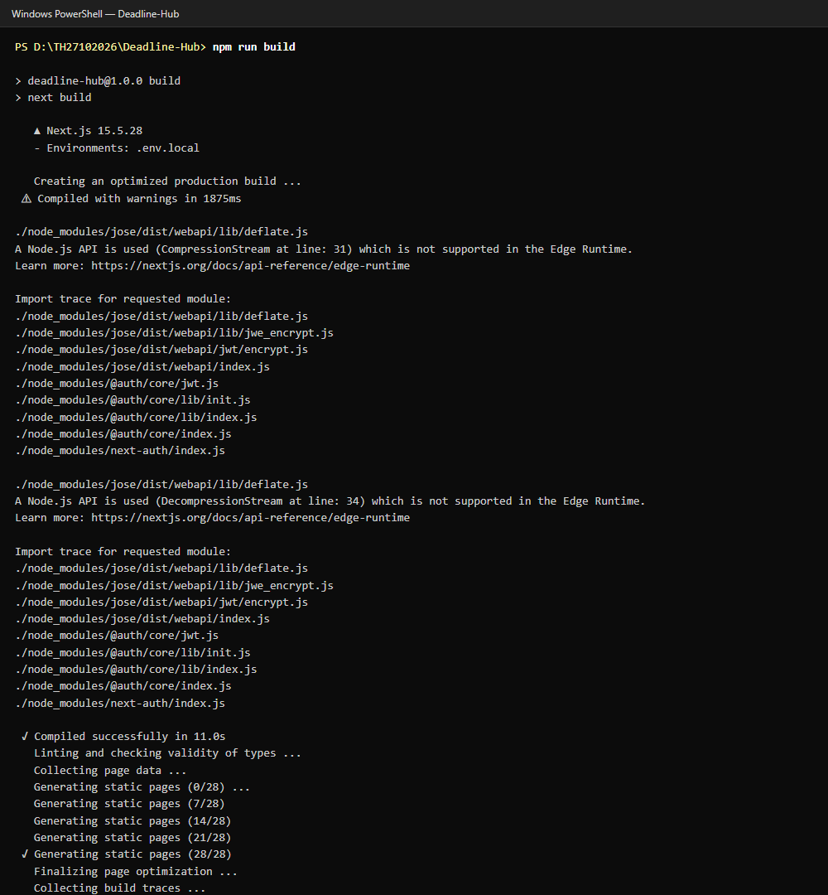

Ký hiệu của Next.js:
- `○` Static: prerender lúc build (SSG).
- `●` SSG có `generateStaticParams`.
- Cột **Revalidate** có giá trị: ISR.
- `ƒ` Dynamic: render ở mỗi request (SSR).

| Route | Build | Chiến lược | Lý do |
|---|---|---|---|
| `/` | `○` | **SSG** | Trang giới thiệu, ai cũng xem, cần nhanh nhất và tốt cho SEO. Phần phụ thuộc thời gian (đếm ngược, số quá hạn, "tuần này") được tính ở client nên HTML tĩnh không bị lỗi thời |
| `/subjects/[slug]` | `●` 4 trang | **SSG** | 4 môn cố định, dựng sẵn hết lúc build. Slug lạ trả 404 ngay (`dynamicParams = false`) |
| `/deadlines` | `○` Revalidate **1m** | **ISR 60 giây** | Trang được xem nhiều nhất. Trả HTML từ cache, dữ liệu mới xuất hiện chậm nhất sau 60 giây. Chấp nhận trễ ngắn để đổi lấy tốc độ |
| `/deadlines/[id]` | `●` một trang cho mỗi deadline | **ISR on-demand** | Xem [câu hỏi (1)](#1-vì-sao-deadlinesid-dùng-isr) |
| `/dashboard` (+ `/pending`, `/done`) | `ƒ` | **SSR** | Nội dung riêng cho từng sinh viên, phải đọc cookie session ở mỗi request, không được cache chung |
| `/admin` | `ƒ` | **SSR** | Chỉ admin; kiểm tra quyền và hiển thị dữ liệu mới nhất ở mỗi request |
| `/login`, `/403` | `ƒ` | SSR | Đọc `callbackUrl` và session |
| `/sitemap.xml` | `○` 1h | ISR 1 giờ | Liệt kê mọi deadline |

---

## 4. Routing và component

- **`(public)`**: layout có header lấy session ở **client** (`useSession`), nhờ vậy các trang công khai vẫn là SSG/ISR. Nếu header gọi `auth()` ở server, cả nhóm sẽ thành dynamic.
- **`(app)`**: layout đọc session ở **server** (`auth()`), mọi trang trong nhóm là SSR.
- **`(auth)/login`**: trang đăng nhập có layout riêng, không có header.
- `/dashboard` có **layout lồng nhau** với sidebar gồm Tổng quan, Chưa xong, Đã xong, Tất cả deadline, Môn học. Mục đang mở được tô đen.

Mặc định mọi thứ là **Server Component**. `'use client'` chỉ có ở:

| Client Component | Lý do |
|---|---|
| `DueBadge`, `Countdown`, `LiveCount`, `NearestDue` | Hiển thị "Còn X ngày / Quá hạn Y ngày" và đếm ngược theo giờ trình duyệt |
| `DeadlineExplorer` | Bộ lọc: tìm theo tên, lọc theo môn, theo trạng thái |
| `MainNav`, `SidebarNav` | Tô sáng menu theo `usePathname()` |
| `SessionUser`, `GuestOnly`, `StatusCard` | Đọc session ở client để trang công khai vẫn tĩnh |
| `CheckRow`, `AddDeadlineForm`, `DeleteButton`, `LoginForm`, `LogoutButton`, `CopyLinkButton` | Form và nút bấm |
| `error.tsx`, `ErrorView`, `MissingPath`, `Providers` | Next.js bắt buộc error boundary và context provider là client |

---

## 5. Xác thực, Middleware và phân quyền

**Đăng nhập:**
- NextAuth (Auth.js v5) với provider Credentials, `session: { strategy: "jwt" }`.
- Dữ liệu đăng nhập được kiểm tra bằng zod, mật khẩu so khớp bằng bcrypt.
- Callback `jwt` và `session` đưa `id`, `role` vào session; kiểu khai báo trong [types/next-auth.d.ts](types/next-auth.d.ts).

**Ma trận phân quyền** chỉ nằm ở [lib/permissions.ts](lib/permissions.ts):

| Hành động | guest | user | admin |
|---|:-:|:-:|:-:|
| `deadline:view`: Xem deadline | ✓ | ✓ | ✓ |
| `deadline:complete`: Đánh dấu đã xong | ✗ | ✓ | ✓ |
| `deadline:create`: Thêm deadline | ✗ | ✗ | ✓ |
| `deadline:delete`: Xoá deadline | ✗ | ✗ | ✓ |

`can(role, action)` được dùng ở Middleware, trang `/admin`, từng Server Action, API `/api/progress`, menu header và sidebar.

**Kiểm tra mã trạng thái route, Middleware và đăng nhập:**

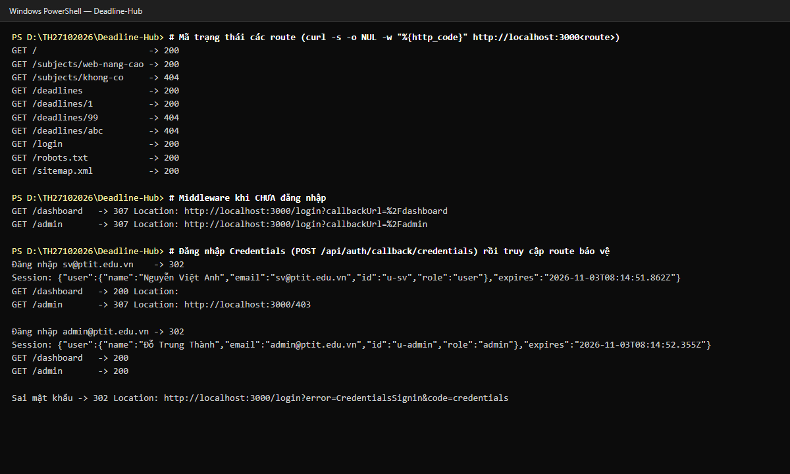

- Chưa đăng nhập vào `/dashboard` hoặc `/admin` thì bị chuyển `307` tới `/login?callbackUrl=…`, giữ đường dẫn quay lại.
- Sinh viên vào `/admin` thì bị chuyển `/403`. Admin vào được.
- Session trả về có `id` và `role`.
- Sai mật khẩu thì quay về `/login?error=CredentialsSignin`.

**Phân quyền không chỉ dựa vào Middleware.** Mình gọi thẳng Server Action bằng request POST tới `/deadlines/1`, route mà Middleware không bảo vệ, kèm header `Next-Action`:

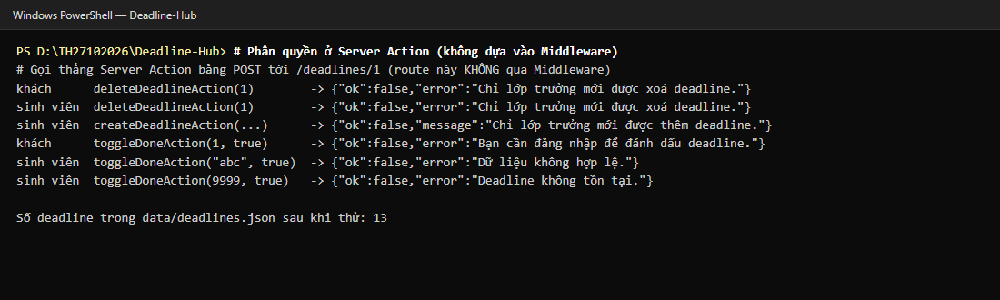

Mọi lần gọi đều bị từ chối bởi `can()` hoặc bởi zod (id sai kiểu, deadline không tồn tại), và số deadline trong file JSON không đổi.

Dữ liệu đầu vào khi thêm deadline được kiểm tra bằng zod:
- tên 3–120 ký tự;
- môn phải tồn tại;
- loại thuộc danh sách cho phép;
- ngày hợp lệ;
- mô tả tối đa 500 ký tự.

Ngoài ra, `callbackUrl` ở `/login` chỉ chấp nhận đường dẫn nội bộ để tránh open redirect.

---

## 6. SEO và tối ưu

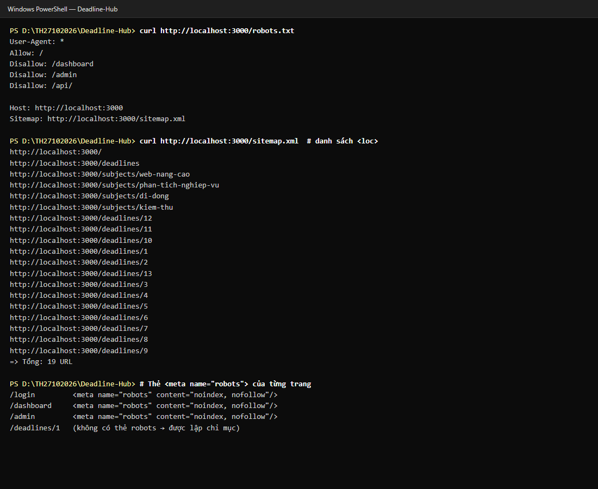

- `robots.txt` chặn `/dashboard`, `/admin` (và `/api/`).
- `sitemap.xml` gồm trang chủ, `/deadlines`, 4 môn và **mọi deadline**.
- `/login`, `/dashboard`, `/admin` có `<meta name="robots" content="noindex, nofollow">`. Trang chi tiết thì được lập chỉ mục.

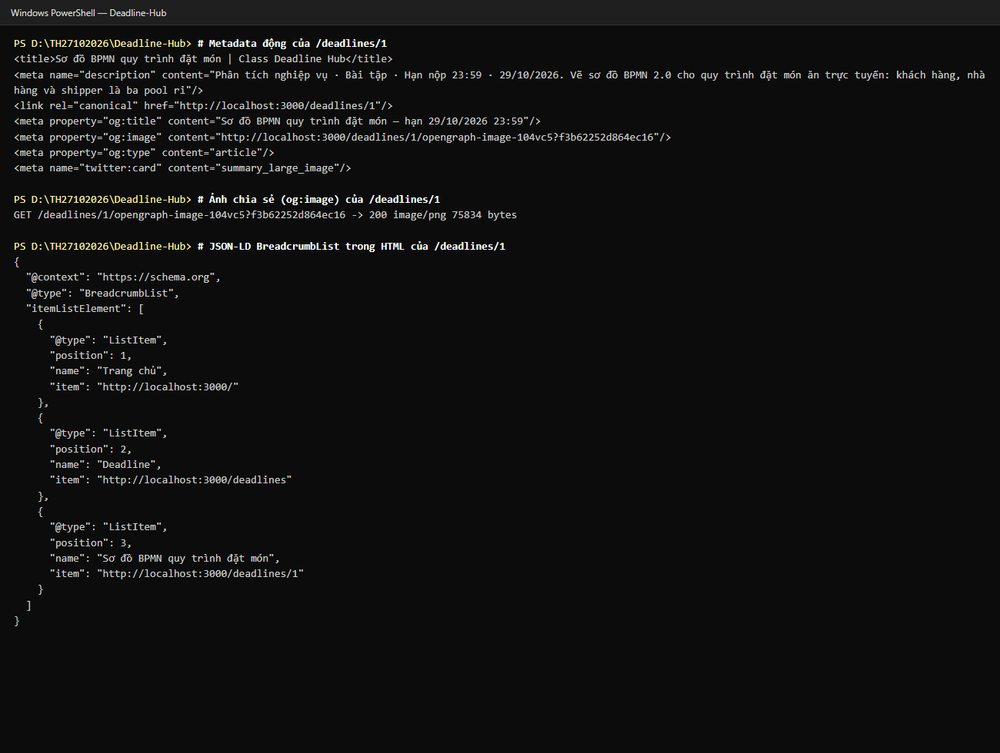

- **Metadata động** (`generateMetadata`): title, description, canonical, Open Graph, Twitter card riêng cho từng deadline.
- **Ảnh chia sẻ** (`opengraph-image.tsx`, 1200×630) sinh riêng cho từng deadline: môn, loại, tên deadline, hạn nộp, "Còn X ngày". Dùng font Anton và Be Vietnam Pro trong [assets/fonts/](assets/fonts/) để hiển thị đúng dấu tiếng Việt.

  
- **JSON-LD BreadcrumbList**: Trang chủ → Deadline → tên deadline.
- **next/font**: Anton (tiêu đề) và Be Vietnam Pro (nội dung), subset `latin` + `vietnamese`, `display: swap`, tự host nên không chặn render.
- **next/image**: logo, hình minh hoạ ở hero, 404, 403, trang môn học, và avatar GitHub.

---

## 7. Điểm Lighthouse

Đo bằng Lighthouse 12 trên **bản production** (`npm run build && npm start`), Chrome headless.

| Trang | Thiết bị | Performance | Accessibility | Best Practices | SEO |
|---|---|:-:|:-:|:-:|:-:|
| `/` | Mobile | **93** | **100** | **100** | **100** |
| `/` | Desktop | **100** | **100** | **100** | **100** |
| `/deadlines/1` | Mobile | **95** | **100** | **100** | **100** |
| `/deadlines/1` | Desktop | **100** | **100** | **100** | **100** |

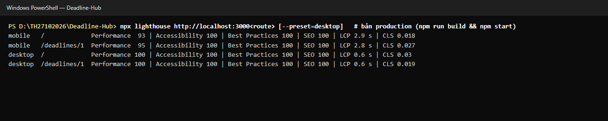

| `/`, Mobile | `/`, Desktop |
|---|---|
| 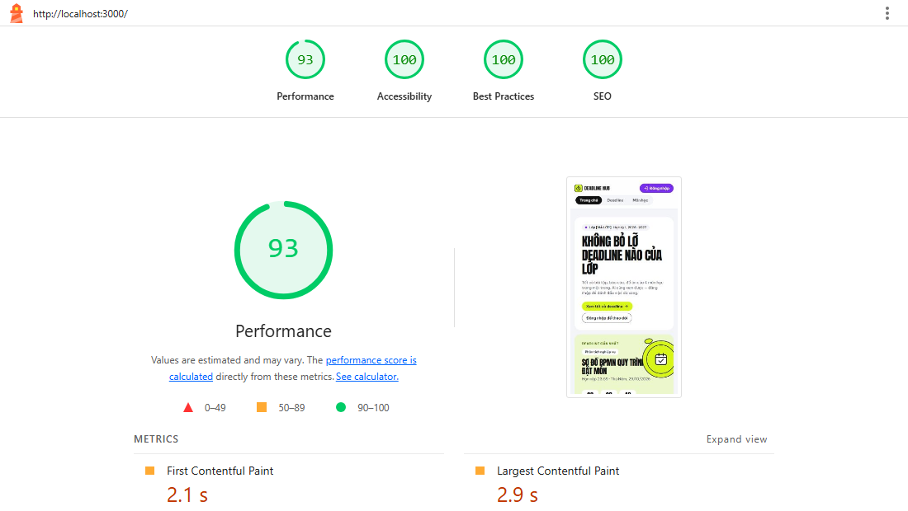 | 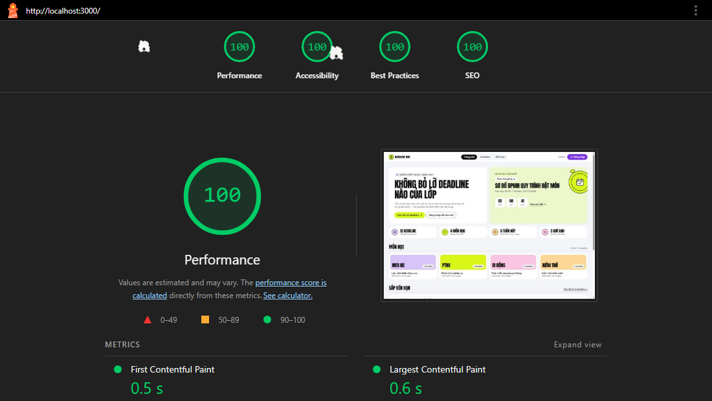 |
| **`/deadlines/1`, Mobile** | **`/deadlines/1`, Desktop** |
| 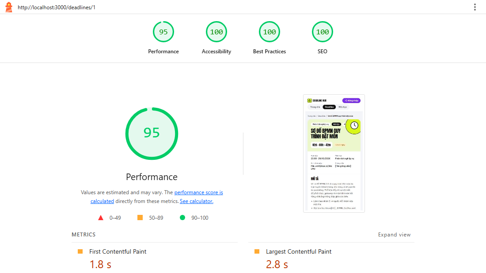 | 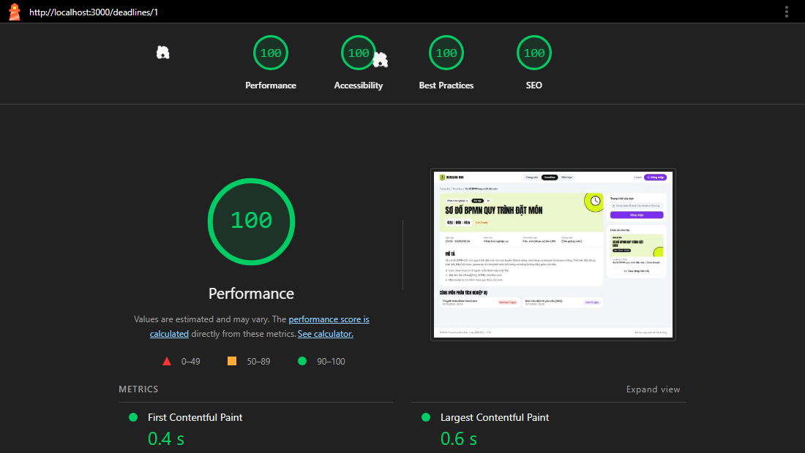 |

Báo cáo đầy đủ, mở bằng trình duyệt: [docs/lighthouse/](docs/lighthouse/).

---

## 8. Ảnh view-source của `/deadlines/1`

HTML server trả về đã chứa sẵn:
- `<title>`, description, canonical, các thẻ `og:*` và `twitter:*`;
- JSON-LD `BreadcrumbList` (dòng 90);
- toàn bộ nội dung: `<h1>`, hạn nộp, môn học, hình thức nộp, mô tả.

Trang được prerender (ISR), bot của Google và mạng xã hội đọc được ngay mà không cần chạy JavaScript.

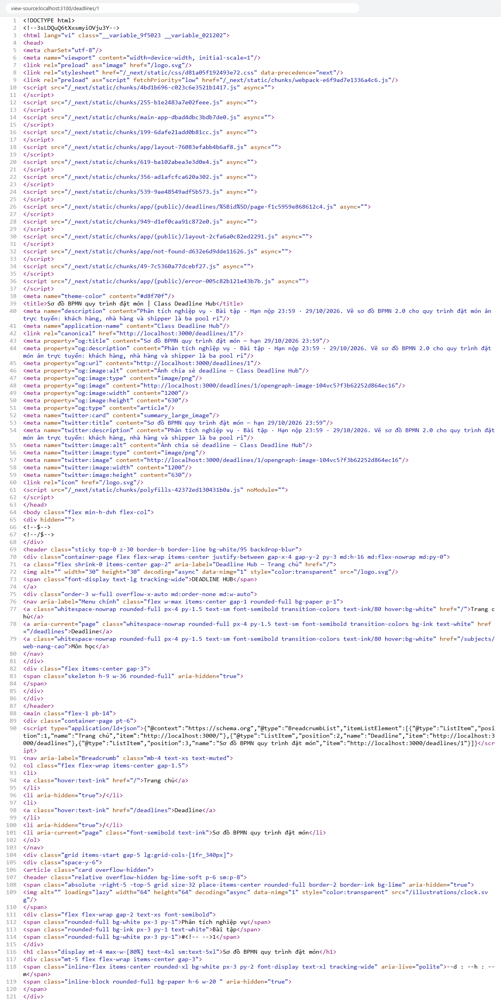

---

## 9. Trả lời câu hỏi

### (1) Vì sao `/deadlines/[id]` dùng ISR?

- **Cần trang tĩnh để nhanh và tốt cho SEO.** Đây là trang được chia sẻ vào nhóm lớp và được Google lập chỉ mục. HTML dựng sẵn (kèm metadata, ảnh OG, JSON-LD) được trả ngay từ cache, không tốn thời gian render ở mỗi lượt xem. Nhờ vậy TTFB và LCP thấp (Lighthouse: Performance 95 trên mobile, 100 trên desktop). Bot của Facebook, Zalo, Google cũng đọc được đầy đủ nội dung.
- **Nhưng dữ liệu vẫn thay đổi.** Lớp trưởng có thể thêm hoặc xoá deadline bất cứ lúc nào:
  - SSG thuần thì phải build lại cả site mới cập nhật.
  - SSR thì mọi lượt xem đều render lại, dù dữ liệu gần như không đổi. Tốn tài nguyên và chậm hơn.
- **ISR on-demand là điểm cân bằng.**
  - Lúc build, `generateStaticParams` dựng sẵn mọi trang.
  - Khi admin thêm hoặc xoá, Server Action gọi `revalidatePath("/(public)/deadlines/[id]", "page")` và `revalidatePath("/deadlines/<id>")`. Cache bị huỷ **ngay**, request tiếp theo nhận bản mới.
  - Danh sách "Cùng môn" ở các trang khác cũng được cập nhật.
  - Deadline vừa xoá trả 404. Deadline mới thêm (`dynamicParams = true`) được dựng ở request đầu tiên rồi cache lại.
- **Khác với `/deadlines` (ISR 60 giây):** trang chi tiết không phải chờ hết chu kỳ thời gian mà được làm mới đúng lúc dữ liệu đổi. Đã kiểm chứng: `/deadlines/13` trả 404, admin thêm thì lập tức trả 200, admin xoá thì lập tức trả 404.
- **Phần thay đổi theo thời gian và theo người dùng** ("Còn X ngày", đếm ngược, "Trạng thái của bạn") được tính ở client, nên trang không cần render lại ở server.

### (2) Nếu chỉ dùng Middleware để bảo vệ `/admin` thì có rủi ro gì?

1. **Server Action là một endpoint POST công khai.** Middleware chỉ chặn theo *đường dẫn trang* (`matcher: /admin/:path*`). Server Action thì gọi được bằng một POST tới **bất kỳ route nào** có import action đó (ví dụ `/deadlines/1`), chỉ cần header `Next-Action`. Nếu action không tự kiểm tra quyền, sinh viên hoặc khách có thể thêm hoặc xoá deadline mà không bao giờ đi qua `/admin`. Ảnh ở [mục 5](#5-xác-thực-middleware-và-phân-quyền) thử đúng tình huống này và bị chặn nhờ `can()` trong action.
2. **Matcher dễ sai hoặc bị bỏ sót.** Đổi tên route, thêm route group, thêm API route mới (`/api/admin/...`) hay viết sai pattern của `matcher` đều có thể làm một trang hoặc endpoint mất bảo vệ mà không ai nhận ra.
3. **Bản thân Middleware có thể có lỗ hổng.** Ví dụ CVE-2025-29927 trong Next.js cho phép bỏ qua Middleware bằng header `x-middleware-subrequest`. Chỉ có một lớp bảo vệ thì một lỗi như vậy làm lộ toàn bộ khu quản trị.
4. **Middleware chỉ thấy JWT ở Edge, không thấy dữ liệu mới nhất.** Nếu vai trò của ai đó bị thu hồi, JWT cũ vẫn qua được Middleware cho tới khi hết hạn. Kiểm tra ở server (trang và action) mới là nơi kiểm soát chắc chắn.
5. **Không kiểm tra dữ liệu đầu vào.** Middleware không đọc body request. Thiếu kiểm tra (zod) ở action thì dữ liệu rác hoặc độc hại (tên rỗng, ngày sai, môn không tồn tại, chuỗi rất dài) sẽ được ghi thẳng vào file JSON.

→ **Kết luận:** Middleware là lớp **trải nghiệm** (chuyển hướng sớm, không render thừa). **Quyền thật** phải được kiểm tra lại ở nơi truy cập dữ liệu: trang `/admin` (`auth()` + `can()`), mọi Server Action và API route, kèm kiểm tra dữ liệu bằng zod. Dự án làm đủ cả ba lớp, dùng chung một hàm `can()`.

---

## 10. Ảnh giao diện

| | |
|---|---|
| **Trang chủ `/`** (SSG, khách) 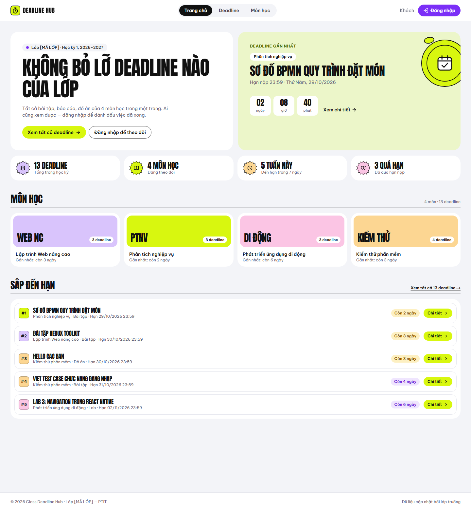 | **Trang chủ khi đã đăng nhập** (ẩn nút "Đăng nhập để theo dõi") 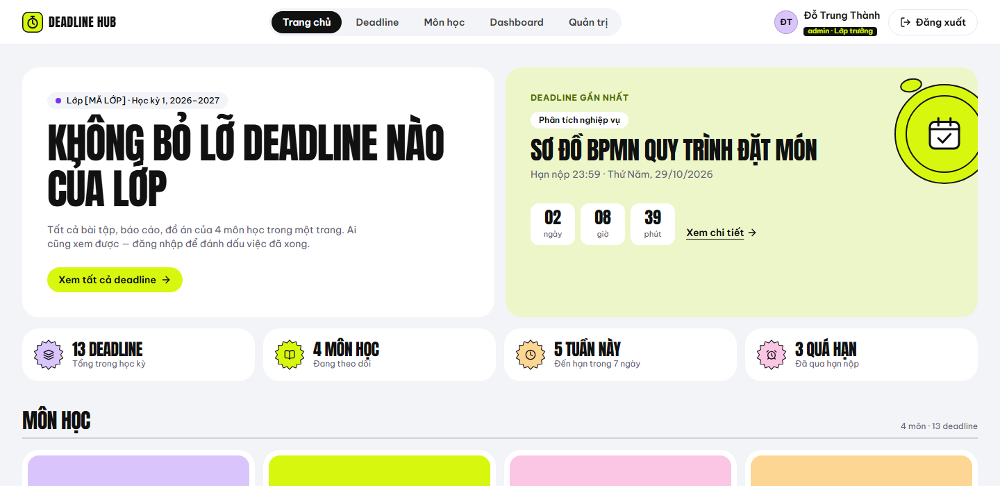 |
| **`/deadlines`** (ISR 60s) 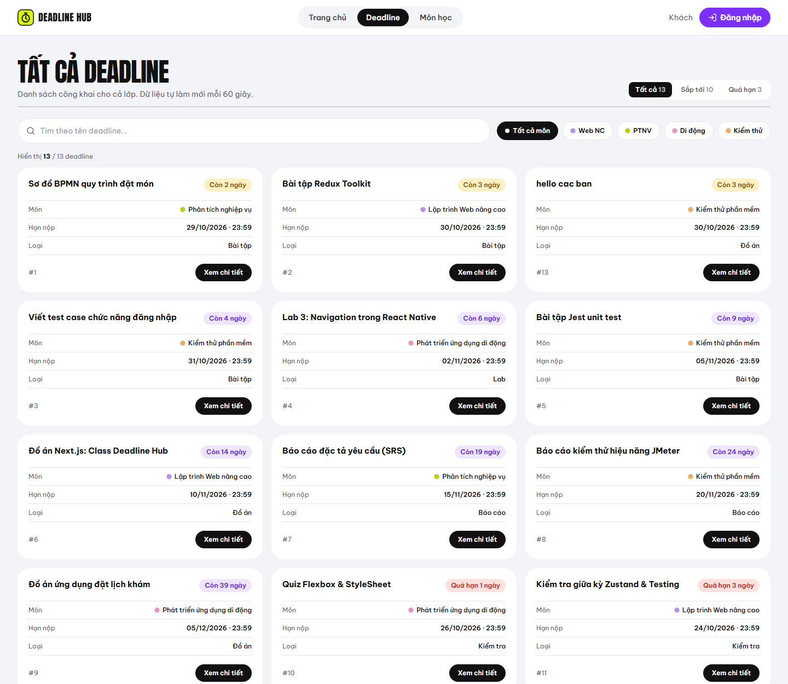 | **Bộ lọc "Quá hạn"** (client component) 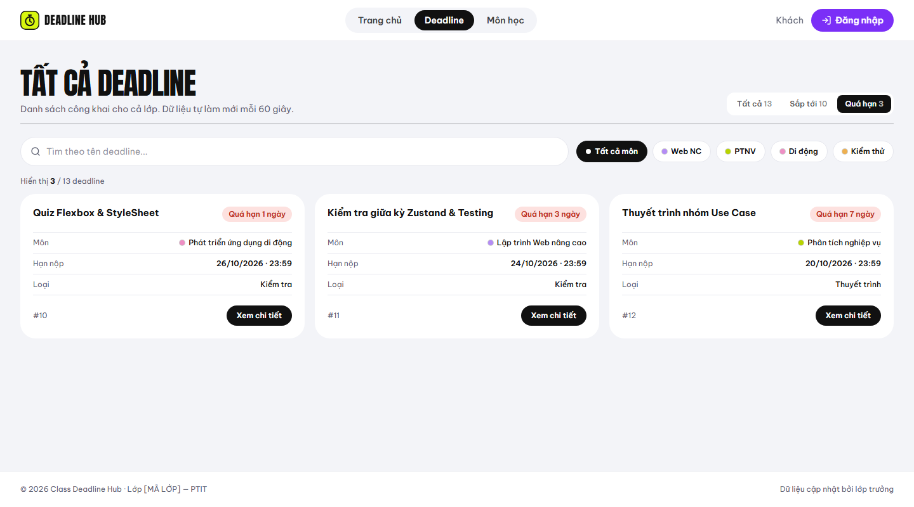 |
| **`/deadlines/1`** (ISR on-demand, khách) 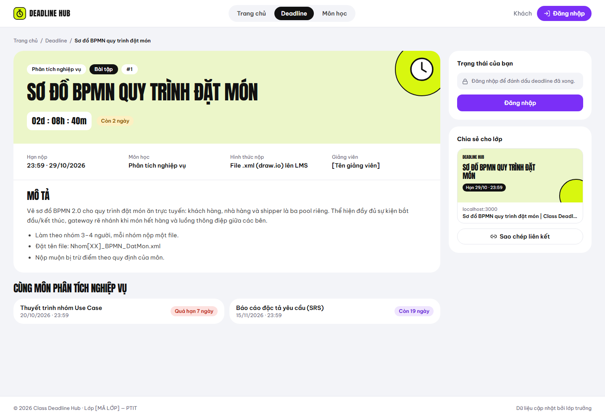 | **`/deadlines/2`** khi sinh viên đã đăng nhập 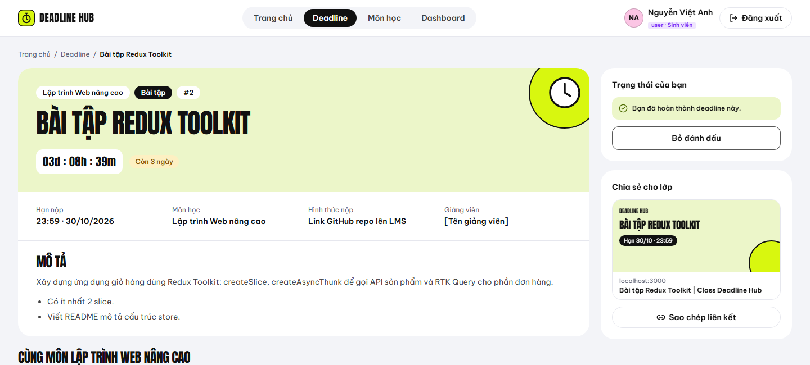 |
| **`/subjects/web-nang-cao`** (SSG) 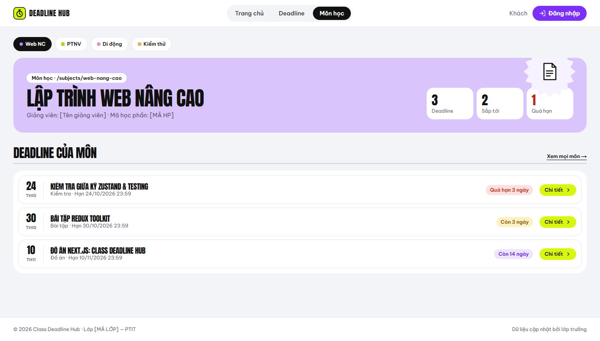 | **`/login`** (noindex, giữ `callbackUrl`) 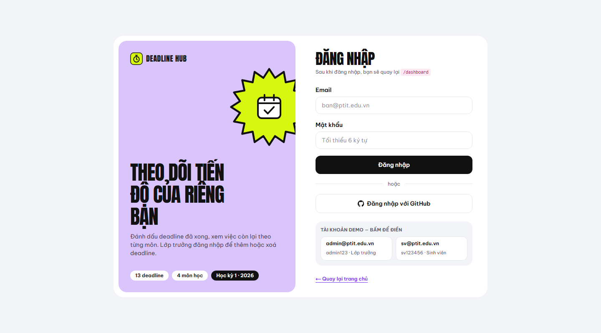 |
| **`/dashboard`** (SSR, sidebar lồng nhau) 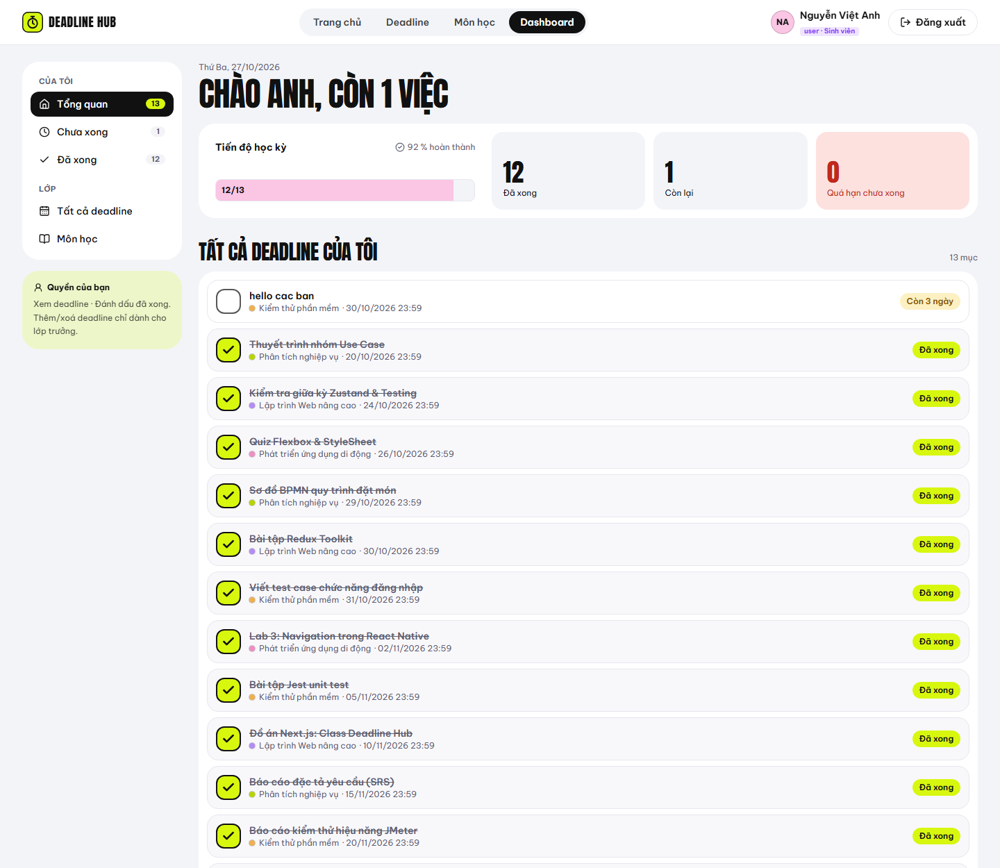 | **`/dashboard/done`** (sidebar tô sáng "Đã xong") 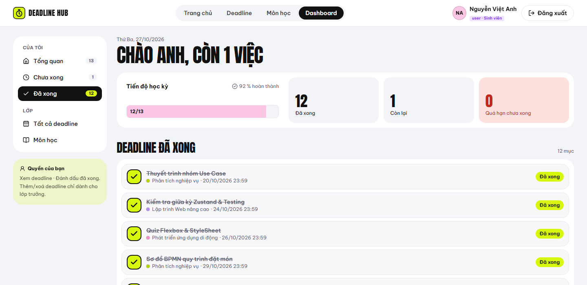 |
| **`/admin`** (SSR, chỉ lớp trưởng) 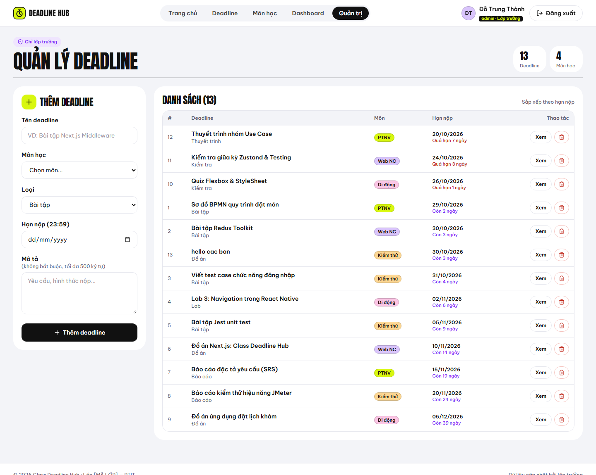 | **`/403`** (sinh viên vào `/admin`) 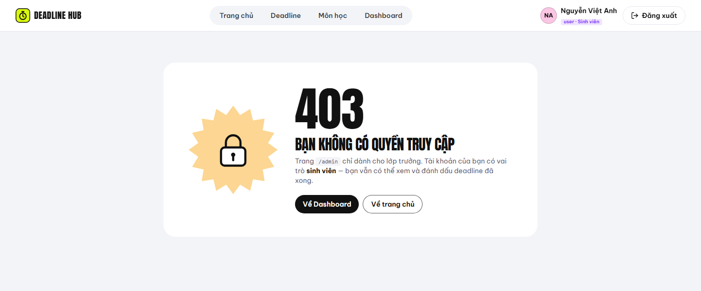 |
| **404** (`/deadlines/99`) 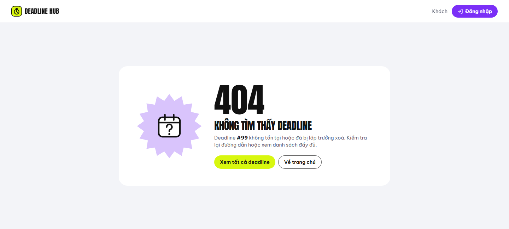 | |

---

## 11. Điểm cộng

**Test Jest cho `can()`: ✅**

[__tests__/permissions.test.ts](__tests__/permissions.test.ts) kiểm tra:
- toàn bộ ma trận 3 vai trò × 4 hành động;
- vai trò `null`/`undefined` được coi như `guest`;
- vai trò hoặc hành động lạ luôn bị từ chối;
- `isSessionRole`.

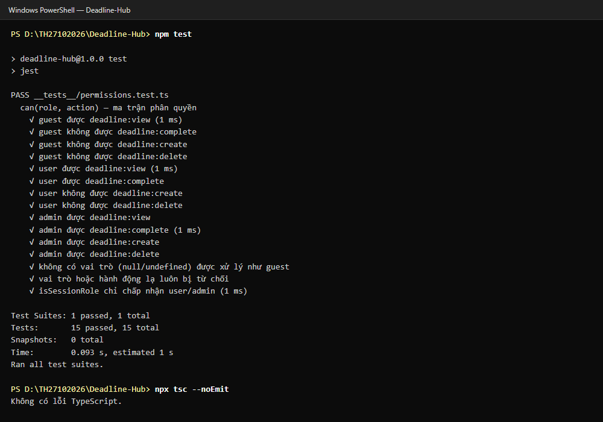

**Đăng nhập GitHub (OAuth): ✅**

Đã tích hợp provider GitHub. Khi có `AUTH_GITHUB_ID` và `AUTH_GITHUB_SECRET`, nút "Đăng nhập với GitHub" ở `/login` được bật. Tài khoản GitHub có id `github:<id>` và vai trò mặc định `user` (sinh viên). Quyền admin chỉ dành cho tài khoản lớp trưởng trong `users.json`.

Cách tạo OAuth App:
1. Vào GitHub → Settings → Developer settings → OAuth Apps → New OAuth App.
2. Homepage URL: `http://localhost:3000`.
3. Authorization callback URL: `http://localhost:3000/api/auth/callback/github`.
4. Chép Client ID và Client Secret vào `.env.local`.

**Deploy Vercel: ⬜**

- `outputFileTracingIncludes` đóng gói `data/` và `assets/`.
- Trên Vercel, thư mục dự án chỉ đọc, nên dữ liệu được sao sang `/tmp` ở lần đọc đầu tiên.
- Các bước: import repo vào Vercel, đặt `AUTH_SECRET` và `NEXT_PUBLIC_SITE_URL=https://<tên-dự-án>.vercel.app`, rồi deploy. Nếu dùng GitHub OAuth, thêm callback URL của domain Vercel.
---

## 12. Cấu trúc thư mục

```
Deadline-Hub/
├─ app/
│  ├─ (public)/                    # nhóm công khai — layout riêng
│  │  ├─ layout.tsx
│  │  ├─ page.tsx                  # /                     SSG
│  │  ├─ error.tsx                 # lỗi + nút "Thử lại"
│  │  ├─ deadlines/
│  │  │  ├─ (list)/page.tsx        # /deadlines            ISR 60s
│  │  │  ├─ (list)/loading.tsx     # skeleton
│  │  │  └─ [id]/
│  │  │     ├─ page.tsx            # /deadlines/[id]       ISR on-demand + metadata + JSON-LD
│  │  │     └─ opengraph-image.tsx # ảnh chia sẻ từng deadline
│  │  └─ subjects/[slug]/page.tsx  # /subjects/[slug]      SSG
│  ├─ (app)/                       # nhóm cần đăng nhập — layout riêng
│  │  ├─ layout.tsx
│  │  ├─ error.tsx
│  │  ├─ dashboard/                # /dashboard            SSR, layout lồng nhau (sidebar)
│  │  │  ├─ layout.tsx, loading.tsx, page.tsx
│  │  │  ├─ pending/page.tsx
│  │  │  └─ done/page.tsx
│  │  ├─ admin/page.tsx            # /admin                SSR, chỉ admin
│  │  └─ 403/page.tsx
│  ├─ (auth)/login/page.tsx        # /login                noindex
│  ├─ actions.ts                   # Server Actions (tự kiểm tra quyền + zod)
│  ├─ api/auth/[...nextauth]/route.ts
│  ├─ api/progress/route.ts
│  ├─ not-found.tsx                # trang 404 của dự án
│  ├─ sitemap.ts, robots.ts, opengraph-image.tsx
│  ├─ layout.tsx                   # next/font
│  └─ globals.css
├─ components/                     # UI (header, dashboard, admin, deadline, ...)
├─ lib/
│  ├─ permissions.ts               # MA TRẬN PHÂN QUYỀN + can()
│  ├─ data.ts                      # đọc/ghi JSON (server-only)
│  ├─ time.ts, types.ts, site.ts, og.tsx
├─ data/                           # subjects.json, deadlines.json, users.json, progress.json
├─ types/next-auth.d.ts            # kiểu Session / JWT
├─ __tests__/permissions.test.ts   # Jest
├─ auth.ts, auth.config.ts         # NextAuth
├─ middleware.ts                   # bảo vệ /dashboard, /admin
├─ public/                         # logo, hình minh hoạ (SVG)
├─ assets/fonts/                   # font cho ảnh OG
├─ docs/                           # ảnh và báo cáo cho README
├─ .env.example, .gitignore, next.config.ts, jest.config.js, tsconfig.json
```
